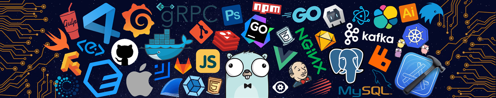
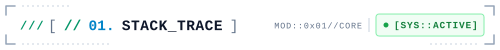
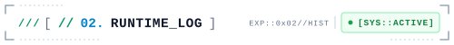
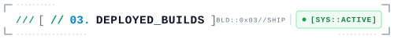
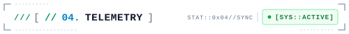
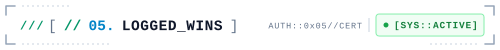

<!-- ====================================================================== -->
<!-- BHARGAVA A — GitHub Profile README                                    -->
<!-- Identity: Centaur Engineer | B.Tech CSBS @ RMKEC '28                  -->
<!-- ====================================================================== -->

<p align="center">
  
</p>

<p align="center">
  <picture>
    <source media="(prefers-color-scheme: dark)" srcset="./dark.svg" />
    <source media="(prefers-color-scheme: light)" srcset="./light.svg" />
    
  </picture>
</p>

<!-- ====================================================================== -->
<!-- SOCIAL & NETWORK RAIL                                                  -->
<!-- ====================================================================== -->

<p align="center">
  <a href="https://bhargavaa.vercel.app/" target="_blank">
    
  </a>
  <a href="https://www.linkedin.com/in/bhargavaa1/" target="_blank">
    
  </a>
  <a href="https://leetcode.com/Bhargava2525/" target="_blank">
    
  </a>
  <a href="https://github.com/bhargava562" target="_blank">
    
  </a>
  <a href="https://x.com/Bhargava3196511" target="_blank">
    
  </a>
  <a href="mailto:bhargavaanand2006@gmail.com">
    
  </a>
</p>

<p align="center">
  
</p>

<br/>

<!-- ====================================================================== -->
<!-- SYSTEM INFO & PHILOSOPHY                                               -->
<!-- ====================================================================== -->

<table align="center" width="100%">
<tr>
<td width="58%" valign="top">

```yaml
$ whoami --verbose

name       : Bhargava A
role       : Python Backend Intern @ Linkific ('26)
community  : Lead @ Google Developer Groups on Campus (RMKEC)
identity   : "Centaur Engineer" — AI as force multiplier,
             not a replacement for engineering judgment
college    : R.M.K. Engineering College
degree     : B.Tech, CS & Business Systems | '24–'28
cgpa       : 8.75 / 10
location   : Greater Chennai Area, India
principle  : Ship the boring 80%, own the hard 20%
```

<h3>🧠 Currently Compiling</h3>

* ⚙️ **Production Backend Systems** — asyncpg poolers, TTL caching & low-latency FastAPI pipelines
* 📐 **30-pattern DSA sprint** — daily competitive programming on LeetCode, CodeForces & AtCoder
* 🛰️ **Orbit** — request-time health-aware credential failover platform (Spring Boot / React)
* ✍️ Weekly engineering deep-dives on LinkedIn — production systems, architecture trade-offs

</td>

<td width="42%" align="center" valign="middle">


</td>
</tr>
</table>

<p align="center">
  
</p>

<br/>

<!-- ====================================================================== -->
<!-- 01. TECH STACK                                                         -->
<!-- ====================================================================== -->

<p align="center">
  
</p>

<table align="center" width="100%">
<tr>

<td align="center" width="50%" valign="top">

**Languages**

<br/>

<a href="https://skillicons.dev">
  
</a>

<br/><br/>

**Frameworks & Libraries**

<br/>

<a href="https://skillicons.dev">
  
</a>

</td>

<td align="center" width="50%" valign="top">

**Data & Infrastructure**

<br/>

<a href="https://skillicons.dev">
  
</a>

<br/><br/>

**Tools & Workflow**

<br/>

<a href="https://skillicons.dev">
  
</a>

</td>

</tr>
</table>

<p align="center">
  
  
  
  
  
</p>

<br/>

<!-- ====================================================================== -->
<!-- 02. EXPERIENCE & LEADERSHIP                                            -->
<!-- ====================================================================== -->

<p align="center">
  
</p>

<table align="center" width="100%">
<tr>
<td width="100%">

### 💼 Work Experience

**`[Apr 2026 → Aug 2026]`** &nbsp; **Python Backend Developer Intern** — Linkific
* Engineered **5+ core auth & user REST endpoints** (JWT, RBAC, bcrypt, Google OAuth 2.0) for a production FastAPI backend.
* Architected a **multi-phase data processing pipeline** reading stored PostgreSQL inputs to compute and generate a sequential timer-scheduled output queue.
* Diagnosed cloud database latency; migrated to **Supabase Shared Pooler (asyncpg)** and TTL caching, cutting warm cloud response times by **~34%** (181 ms → 120 ms on Render; ~23 ms locally).
* Hardened endpoints with **SlowAPI rate limiting**, authored an **11-phase test suite**, and achieved an architecture review score of **9.5/10**.

<br/>

**`[Jun 2025 → Jul 2025]`** &nbsp; **Frontend Developer Intern** — The Entrepreneurship Network
* Developed responsive user interfaces using **React** and **Tailwind CSS**, delivering 28 JSX components across 8 routes for the TEN Tech Competition Engine.
* Optimized client-side routing, state management with `useCallback`/`useEffect`, and implemented React Error Boundaries for fault-tolerant UI (1.62s LCP, 0.00 CLS).

<hr/>

### 🤝 Volunteering & Community Leadership

**`[Oct 2026 → Present]`** &nbsp; **Lead** — Google Developer Groups on Campus (GDGoC RMK)
* Directing campus developer community, organizing **Google Cloud Study Jam**, mentoring students through GCP labs, and designing automated certificate issuance workflows.

<br/>

**`[Dec 2025 → Oct 2026]`** &nbsp; **Tech Team Member** — Google Developer Groups on Campus (GDGoC RMK)
* Engineered an **interactive technical quiz application** for live developer events and provided hands-on technical mentoring across workshops.

</td>
</tr>
</table>

<br/>

<!-- ====================================================================== -->
<!-- 03. FEATURED BUILDS                                                    -->
<!-- ====================================================================== -->

<p align="center">
  
</p>

<table align="center" width="100%">
<tr>

<td width="50%" valign="top">

### 🛰️ Orbit
**Request-Time Health-Aware Credential Failover Platform**


> **Flagship Platform** — Enterprise developer platform that dynamically fails over API credentials at request time based on live health signals rather than static config. *In active development toward MVP.*

</td>

<td width="50%" valign="top">

### 🛡️ BlockSafe
**Autonomous Cognitive Firewall & Honeypot**


> Real-time adversarial deception and cognitive firewall powered by a LangGraph multi-agent swarm — detects subtle psychological manipulation to neutralize scammers. **2nd Place (₹15,000) — SVCE Yet Another Hackathon 2026.**

[](https://github.com/bhargava562/BlockSafe)

</td>

</tr>

<tr>

<td width="50%" valign="top">

### 🤖 Friday
**Java CLI AI Assistant**


> Intelligent command-line assistant powered by Gemini API, integrating 10+ external APIs (Google Calendar, Wolfram Alpha, GNews) with Jackson-persisted reminders and desktop notifications.

[](https://github.com/bhargava562/Friday)

</td>

<td width="50%" valign="top">

### 💻 Portfolio OS
**Ubuntu Web Desktop Simulation**


> Interactive web desktop recreating the Ubuntu OS experience in the browser — features PostgreSQL distributed locking (`UPDATE...RETURNING`), lazy-loading cutting bundle size by 96% (500KB → 20KB).

[](https://bhargavaa.vercel.app/)

</td>

</tr>
</table>

<br/>

<!-- ====================================================================== -->
<!-- 04. TELEMETRY & ANALYTICS                                              -->
<!-- ====================================================================== -->

<p align="center">
  
</p>

<!-- GitHub Stats Grid -->
<table align="center" width="100%">
<tr>
<td align="center" width="50%">
  <picture>
    <source media="(prefers-color-scheme: dark)" srcset="https://github-readme-stats.vercel.app/api?username=bhargava562&show_icons=true&theme=tokyonight&hide_border=true&bg_color=06090E&title_color=00FF9C&icon_color=00F3FF&text_color=94A3B8&include_all_commits=true&count_private=true" />
    
  </picture>
</td>
<td align="center" width="50%">
  <picture>
    <source media="(prefers-color-scheme: dark)" srcset="https://github-readme-stats.vercel.app/api/top-langs/?username=bhargava562&layout=compact&theme=tokyonight&hide_border=true&bg_color=06090E&title_color=00FF9C&text_color=94A3B8&langs_count=8" />
    
  </picture>
</td>
</tr>
<tr>
<td align="center" width="50%">
  <picture>
    <source media="(prefers-color-scheme: dark)" srcset="https://github-profile-summary-cards.vercel.app/api/cards/stats?username=bhargava562&theme=tokyonight" />
    
  </picture>
</td>
<td align="center" width="50%">
  <picture>
    <source media="(prefers-color-scheme: dark)" srcset="https://github-profile-summary-cards.vercel.app/api/cards/most-commit-language?username=bhargava562&theme=tokyonight" />
    
  </picture>
</td>
</tr>
</table>

<p align="center">
  <picture>
    <source media="(prefers-color-scheme: dark)" srcset="https://streak-stats.demolab.com?user=bhargava562&theme=tokyonight&hide_border=true&background=06090E&ring=00FF9C&fire=00F3FF&currStreakLabel=00FF9C" />
    
  </picture>
</p>

<p align="center">
  <picture>
    <source media="(prefers-color-scheme: dark)" srcset="https://github-profile-trophy.vercel.app/?username=bhargava562&theme=tokyonight&no-frame=true&no-bg=true&row=1&column=7&margin-w=4" />
    
  </picture>
</p>

<h3 align="center">⚔️ Competitive Programming Handles</h3>

<p align="center">
  <a href="https://leetcode.com/Bhargava2525/" target="_blank">
    
  </a>
  <a href="https://codolio.com/profile/bhargavA45" target="_blank">
    
  </a>
  <a href="https://codeforces.com/profile/bhargava_a5" target="_blank">
    
  </a>
  <a href="https://atcoder.jp/users/bhargavaa1" target="_blank">
    
  </a>
  <a href="https://www.hackerrank.com/profile/Bhargava_A_056" target="_blank">
    
  </a>
</p>

<p align="center">
  <picture>
    <source media="(prefers-color-scheme: dark)" srcset="https://leetcard.jacoblin.cool/Bhargava2525?theme=dark&font=JetBrains%20Mono&ext=heatmap&border=0&radius=10" />
    
  </picture>
</p>

<p align="center">
  
  
  
  
</p>

<p align="center">
  <picture>
    <source media="(prefers-color-scheme: dark)" srcset="https://github-readme-activity-graph.vercel.app/graph?username=bhargava562&bg_color=06090E&color=00FF9C&line=00FF9C&point=00F3FF&area=true&hide_border=true&area_color=0d1424" />
    
  </picture>
</p>

<br/>

<!-- ====================================================================== -->
<!-- 05. CONTRIBUTION SNAKE                                                 -->
<!-- ====================================================================== -->

<h3 align="center">🐍 GitHub Contribution Snake Animation</h3>

<p align="center">
  <picture>
    <source media="(prefers-color-scheme: dark)" srcset="./assets/snake/github-snake-dark.svg" />
    
  </picture>
</p>

<br/>

<!-- ====================================================================== -->
<!-- 06. ACHIEVEMENTS & CERTIFICATIONS                                      -->
<!-- ====================================================================== -->

<p align="center">
  
</p>

<p align="center">
  
  <br/><br/>
  
  <br/><br/>
  
  <br/><br/>
  
  <br/><br/>
  
  <br/><br/>
  
  <br/><br/>
  
</p>

<br/>

<!-- ====================================================================== -->
<!-- 07. OPEN CHANNELS                                                      -->
<!-- ====================================================================== -->

<p align="center">
  
</p>

<p align="center">
  Open to <strong>Software Engineering (2028)</strong> & <strong>Backend / AI-Native Systems</strong> engineering opportunities
  <br/>
  <em>FastAPI · Spring Boot · System Design · Agentic Architectures</em>
</p>

<p align="center">
  <a href="mailto:bhargavaanand2006@gmail.com">
    
  </a>
  &nbsp;
  <a href="https://bhargavaa.vercel.app/" target="_blank">
    
  </a>
  &nbsp;
  <a href="https://www.linkedin.com/in/bhargavaa1/" target="_blank">
    
  </a>
</p>

<p align="center">
  
</p>

<br/>

<!-- ====================================================================== -->
<!-- FOOTER                                                                 -->
<!-- ====================================================================== -->

<picture>
  <source media="(prefers-color-scheme: dark)" srcset="https://capsule-render.vercel.app/api?type=blur&color=0:000000,50:06090E,100:000000&height=100&section=footer&animation=fadeIn" />
  
</picture>
