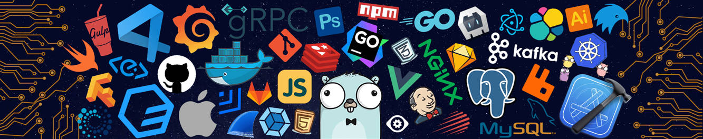
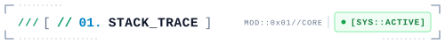
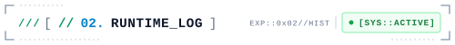
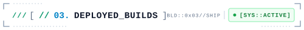
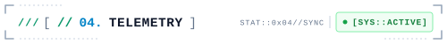
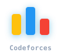
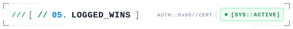

<!-- ====================================================================== -->
<!-- BHARGAVA A — GitHub Profile README                                    -->
<!-- Identity: Centaur Engineer | B.Tech CSBS @ RMKEC '28                  -->
<!-- ====================================================================== -->

<p align="center">
  
</p>

<p align="center">
  <picture>
    <source media="(prefers-color-scheme: dark)" srcset="./dark.svg?v=2.2" />
    <source media="(prefers-color-scheme: light)" srcset="./light.svg?v=2.2" />
    
  </picture>
</p>

<!-- ====================================================================== -->
<!-- SOCIAL & NETWORK RAIL                                                  -->
<!-- ====================================================================== -->

<div align="center">
  <a href="https://bhargavaa.vercel.app/" target="_blank"></a>&nbsp;&nbsp;&nbsp;&nbsp;&nbsp;<a href="https://www.linkedin.com/in/bhargavaa1/" target="_blank"></a>&nbsp;&nbsp;&nbsp;&nbsp;&nbsp;<a href="https://github.com/bhargava562" target="_blank"></a>&nbsp;&nbsp;&nbsp;&nbsp;&nbsp;<a href="https://leetcode.com/Bhargava2525/" target="_blank"></a>&nbsp;&nbsp;&nbsp;&nbsp;&nbsp;<a href="mailto:bhargavaanand2006@gmail.com" target="_blank"></a>&nbsp;&nbsp;&nbsp;&nbsp;&nbsp;<a href="https://x.com/Bhargava3196511" target="_blank"></a>
</div>

<p align="center">
  
</p>

<br/>

<!-- ====================================================================== -->
<!-- SYSTEM INFO & PHILOSOPHY                                               -->
<!-- ====================================================================== -->

<table align="center" width="100%">
<tr>
<td width="58%" valign="top">

```yaml
$ whoami

name      : Bhargava A
role      : Full-Stack & AI Systems Developer
community : Lead @ Google Developer Groups on Campus (RMKEC)
identity  : "VIP Engineer" (Centaur / AI-Augmented Systems)
location  : Avadi, Chennai, India
principle : Ship the boring 80%, own the hard 20%
```

<h3>⚡ Active Focus</h3>

* 🛰️ **Orbit Platform** — Request-time credential failover & resilience engine
* 🤖 **AI-Native Systems** — Multi-agent swarms (LangGraph), Claude MCP & low-latency APIs
* 📐 **DSA & Core Systems** — Daily competitive problem-solving & distributed architecture

</td>

<td width="42%" align="center" valign="middle">


</td>
</tr>
</table>

<p align="center">
  
</p>

<br/>

<!-- ====================================================================== -->
<!-- 01. TECH STACK                                                         -->
<!-- ====================================================================== -->

<p align="center">
  
</p>

<table align="center" width="100%">
<tr>
<th align="center" width="50%">💻 LANGUAGES & CORE</th>
<th align="center" width="50%">🌐 FULL-STACK FRAMEWORKS</th>
</tr>
<tr>
<td align="center" valign="top">
<br/>
&nbsp;&nbsp;
&nbsp;&nbsp;
&nbsp;&nbsp;
&nbsp;&nbsp;
&nbsp;&nbsp;

<br/><br/>
<code>Java 21 (OCP)</code> • <code>Python</code> • <code>TypeScript</code> • <code>JavaScript</code> • <code>C++</code> • <code>C</code>
<br/><br/>
</td>
<td align="center" valign="top">
<br/>
&nbsp;&nbsp;
&nbsp;&nbsp;
&nbsp;&nbsp;
&nbsp;&nbsp;
&nbsp;&nbsp;

<br/><br/>
<code>React 19</code> • <code>Next.js 15</code> • <code>Vite.js</code> • <code>Tailwind</code> • <code>FastAPI</code> • <code>Spring Boot</code>
<br/><br/>
</td>
</tr>
<tr>
<th align="center" width="50%">🗄️ DATA & INFRASTRUCTURE</th>
<th align="center" width="50%">🛠️ TOOLS & WORKFLOW</th>
</tr>
<tr>
<td align="center" valign="top">
<br/>
&nbsp;&nbsp;
&nbsp;&nbsp;
&nbsp;&nbsp;
&nbsp;&nbsp;
&nbsp;&nbsp;

<br/><br/>
<code>PostgreSQL</code> • <code>MongoDB</code> • <code>Redis</code> • <code>Supabase</code> • <code>Docker</code> • <code>Linux</code>
<br/><br/>
</td>
<td align="center" valign="top">
<br/>
&nbsp;&nbsp;
&nbsp;&nbsp;
&nbsp;&nbsp;
&nbsp;&nbsp;
&nbsp;&nbsp;

<br/><br/>
<code>Git</code> • <code>GitHub Actions</code> • <code>VS Code</code> • <code>IntelliJ</code> • <code>Postman</code> • <code>Notion</code>
<br/><br/>
</td>
</tr>
<tr>
<th align="center" width="50%">🧠 GENERATIVE AI PLATFORMS</th>
<th align="center" width="50%">🤖 AGENTIC CODING SYSTEMS</th>
</tr>
<tr>
<td align="center" valign="top">
<br/>
&nbsp;&nbsp;
&nbsp;&nbsp;
&nbsp;&nbsp;

<br/><br/>
<code>ChatGPT</code> • <code>Gemini</code> • <code>Claude</code> • <code>Perplexity AI</code>
<br/><br/>
</td>
<td align="center" valign="top">
<br/>
&nbsp;&nbsp;
&nbsp;&nbsp;
&nbsp;&nbsp;

<br/><br/>
<code>Antigravity</code> • <code>GitHub Copilot</code> • <code>Claude Code</code> • <code>Codex</code>
<br/><br/>
</td>
</tr>
</table>

<br/>

<!-- ====================================================================== -->
<!-- 02. EXPERIENCE & LEADERSHIP                                            -->
<!-- ====================================================================== -->

<p align="center">
  
</p>

<table align="center" width="100%">
<tr>
<td width="100%">

### 💼 Professional Experience

#### ⚡ Python Backend Developer Intern &nbsp;•&nbsp; **Linkific**
`Apr 2026 – Aug 2026` &nbsp;•&nbsp; `Remote` &nbsp;•&nbsp; `Backend & Distributed Systems`  
**Stack:** <code>FastAPI</code> <code>PostgreSQL</code> <code>Supabase</code> <code>Redis</code> <code>Python</code> <code>Docker</code>

- **Cloud Latency Reduction (~34%)** — Diagnosed cloud database bottleneck; migrated production service to **Supabase Shared Pooler (asyncpg)** with TTL caching, slashing warm cloud response times by **~34%** (181 ms → 120 ms on Render; ~23 ms locally).
- **Auth & Security Infrastructure** — Engineered **5+ core auth & user REST endpoints** incorporating **JWT, granular RBAC, bcrypt password hashing**, and **Google OAuth 2.0**.
- **Testing & Reliability** — Hardened endpoints with **SlowAPI rate limiting** and authored an exhaustive **11-phase test suite** ensuring zero-regression releases.
- **Data Processing Pipeline** — Architected an automated data pipeline reading stored PostgreSQL inputs to compute and generate a sequential timer-scheduled output queue.

<hr/>

#### 🌐 Frontend Developer Intern &nbsp;•&nbsp; **The Entrepreneurship Network**
`Jun 2025 – Jul 2025` &nbsp;•&nbsp; `Remote` &nbsp;•&nbsp; `Frontend Engineering`  
**Stack:** <code>React 19</code> <code>Tailwind CSS</code> <code>JavaScript</code> <code>HTML5</code> <code>CSS3</code>

- **Modular UI Components** — Developed responsive interfaces delivering **28 modular JSX components across 8 routes** for the flagship TEN Tech Competition Engine.
- **Core Web Vitals Optimization** — Tuned client-side routing and state hooks (<code>useCallback</code>, <code>useEffect</code>), clocking **1.62s LCP and 0.00 CLS** Core Web Vitals.
- **Fault-Tolerant UI** — Implemented **React Error Boundaries** preventing cascading failures and guaranteeing graceful UI fallback states.

<hr/>

### 🤝 Leadership & Community

#### 👑 Lead Organizer &nbsp;•&nbsp; **Google Developer Groups on Campus (GDGoC RMK)**
`Oct 2026 – Present` &nbsp;•&nbsp; `Campus Community Lead` &nbsp;•&nbsp; `RMKEC`
- Spearheading developer community initiatives, technical workshops, and hackathons, bridging peer learning with Google developer ecosystem technologies.

<br/>

#### 🛠️ Technical Team Member &nbsp;•&nbsp; **Google Developer Groups on Campus (GDGoC RMK)**
`Dec 2025 – Oct 2026` &nbsp;•&nbsp; `Technical Core` &nbsp;•&nbsp; `RMKEC`
- Orchestrated hands-on technical sessions and campus engineering challenges in competitive programming and cloud computing.

</td>
</tr>
</table>

<br/>

<!-- ====================================================================== -->
<!-- 03. FEATURED BUILDS                                                    -->
<!-- ====================================================================== -->

<p align="center">
  
</p>

<table align="center" width="100%">
<tr>

<td width="50%" valign="top">

### 🛰️ Orbit
**Request-Time Health-Aware Credential Failover Platform**  
<code>Java 21</code> <code>Spring Boot</code> <code>React 19</code>

> **Flagship Platform** — Enterprise developer platform that dynamically fails over API credentials at request time based on live health signals rather than static config. *In active development toward MVP.*

</td>

<td width="50%" valign="top">

### 🛡️ BlockSafe
**Autonomous Cognitive Firewall & Honeypot**  
<code>FastAPI</code> <code>LangGraph</code> <code>Groq</code>

> Real-time adversarial deception and cognitive firewall powered by a LangGraph multi-agent swarm — detects subtle psychological manipulation to neutralize scammers. **2nd Place (₹15,000) — SVCE Yet Another Hackathon 2026.**

<a href="https://github.com/bhargava562/BlockSafe" target="_blank"></a>

</td>

</tr>

<tr>

<td colspan="2" width="100%" valign="top">

### 🤖 Friday
**Java CLI AI Assistant**  
<code>Java 21</code> <code>Spring Boot</code> <code>Gemini API</code>

> Intelligent command-line assistant powered by Gemini API, integrating 10+ external APIs (Google Calendar, Wolfram Alpha, GNews) with Jackson-persisted reminders and desktop notifications.

<a href="https://github.com/bhargava562/Friday" target="_blank"></a>

</td>

</tr>
</table>

<br/>

<!-- ====================================================================== -->
<!-- 04. TELEMETRY & ANALYTICS                                              -->
<!-- ====================================================================== -->

<p align="center">
  
</p>

<!-- GitHub Telemetry Grid -->
<table align="center" width="100%">
<tr>
<td align="center" width="50%">
  <picture>
    <source media="(prefers-color-scheme: dark)" srcset="https://github-profile-summary-cards.vercel.app/api/cards/stats?username=bhargava562&theme=tokyonight" />
    
  </picture>
</td>
<td align="center" width="50%">
  <picture>
    <source media="(prefers-color-scheme: dark)" srcset="https://github-profile-summary-cards.vercel.app/api/cards/most-commit-language?username=bhargava562&theme=tokyonight" />
    
  </picture>
</td>
</tr>
</table>

<p align="center">
  <picture>
    <source media="(prefers-color-scheme: dark)" srcset="https://streak-stats.demolab.com?user=bhargava562&theme=tokyonight&hide_border=true&background=06090E&ring=00FF9C&fire=00F3FF&currStreakLabel=00FF9C" />
    
  </picture>
</p>

<h3 align="center">🏆 GitHub Accolades & Trophies</h3>

<p align="center">
  
  &nbsp;
  
  &nbsp;
  
  <br/><br/>
  
  &nbsp;
  
  &nbsp;
  
</p>

<h3 align="center">⚔️ Competitive Programming Handles</h3>

<div align="center">
  <a href="https://leetcode.com/Bhargava2525/" target="_blank"></a>&nbsp;&nbsp;&nbsp;&nbsp;&nbsp;&nbsp;&nbsp;<a href="https://www.hackerrank.com/profile/Bhargava_A_056" target="_blank"></a>&nbsp;&nbsp;&nbsp;&nbsp;&nbsp;&nbsp;&nbsp;<a href="https://codeforces.com/profile/bhargava_a5" target="_blank"></a>&nbsp;&nbsp;&nbsp;&nbsp;&nbsp;&nbsp;&nbsp;<a href="https://codolio.com/profile/bhargavA45" target="_blank"></a>
</div>

<p align="center">
  <picture>
    <source media="(prefers-color-scheme: dark)" srcset="https://leetcard.jacoblin.cool/Bhargava2525?theme=dark&font=JetBrains%20Mono&ext=heatmap&border=0&radius=10" />
    
  </picture>
</p>

<p align="center">
  
  
  
  
</p>

<br/>

<!-- ====================================================================== -->
<!-- 05. CONTRIBUTION SNAKE                                                 -->
<!-- ====================================================================== -->

<h3 align="center">🐍 GitHub Contribution Snake Animation</h3>

<p align="center">
  <picture>
    <source media="(prefers-color-scheme: dark)" srcset="./assets/snake/github-snake-dark.svg" />
    
  </picture>
</p>

<br/>

<!-- ====================================================================== -->
<!-- 06. ACHIEVEMENTS & CERTIFICATIONS                                      -->
<!-- ====================================================================== -->

<p align="center">
  
</p>

<table align="center" width="100%">
<thead>
<tr>
<th align="left" width="50%">🏆 Hackathons & Competitions</th>
<th align="left" width="50%">📜 Industry Certifications</th>
</tr>
</thead>
<tbody>
<tr>
<td valign="top">
  <ul>
    <li>🥇 <strong>2nd Place (₹15,000)</strong> — <em>SVCE Yet Another Hackathon 2026</em> (BlockSafe AI Swarm)</li>
    <li>⚡ <strong>Rank 452 / 12,885 (Top 3.5%)</strong> — <em>HackerRank Orchestrate 2026</em></li>
    <li>🛡️ <strong>National Finalist</strong> — <em>IOB CyberNova 2025</em> (MUSKETS / PFCE)</li>
  </ul>
</td>
<td valign="top">
  <ul>
    <li>☕ <strong>Oracle Certified Professional</strong> — <em>Java SE 21 Developer (1Z0-830)</em></li>
    <li>🧠 <strong>Oracle Cloud Infrastructure</strong> — <em>OCI Generative AI & Vector Search Certified</em></li>
    <li>🤖 <strong>Google / Kaggle</strong> — <em>5-Day AI Agents Intensive Certified</em></li>
  </ul>
</td>
</tr>
</tbody>
</table>

<br/>

<!-- ====================================================================== -->
<!-- 07. OPEN CHANNELS                                                      -->
<!-- ====================================================================== -->

<p align="center">
  
</p>

<table align="center" width="100%">
<thead>
<tr>
<th align="left" width="32%">📡 TELEMETRY / STATUS</th>
<th align="left" width="68%">⚡ SPECIFICATION & DISPATCH PARAMETERS</th>
</tr>
</thead>
<tbody>
<tr>
<td><b>🟢 Status & Availability</b></td>
<td>
  <code>ONLINE</code> &nbsp; <code>OPEN FOR SWE '28</code> &nbsp; <code>FULL-STACK + AI</code>
  <br/>
  <strong>Full-Stack & AI-Native Systems Engineering</strong> <i>(Modern Frontends + High-Scale Backends + Agentic Swarms)</i>
</td>
</tr>
<tr>
<td><b>⚡ Response SLA</b></td>
<td>
  <code>&lt; 24 HOURS</code> &nbsp; <code>DIRECT PRIORITY</code>
  <br/>
  <em>Guaranteed priority response for full-stack engineering roles, collaborative builds, and technical discussions.</em>
</td>
</tr>
<tr>
<td><b>🛠️ Key Vectors</b></td>
<td>
  <code>React 19</code> · <code>Next.js 15</code> · <code>Tailwind CSS</code> · <code>FastAPI</code> · <code>Spring Boot</code> · <code>System Design</code> · <code>Multi-Agent Swarms</code> · <code>PostgreSQL / Redis</code>
</td>
</tr>
<tr>
<td><b>📍 Node Coordinates</b></td>
<td>
  <code>Avadi, Chennai, India</code> &nbsp;•&nbsp; <em>Open to Relocation & Remote Engagements Worldwide</em>
</td>
</tr>
</tbody>
</table>

<br/>

<div align="center">
  <a href="mailto:bhargavaanand2006@gmail.com" target="_blank"></a>&nbsp;&nbsp;&nbsp;&nbsp;&nbsp;&nbsp;&nbsp;<a href="https://www.linkedin.com/in/bhargavaa1/" target="_blank"></a>&nbsp;&nbsp;&nbsp;&nbsp;&nbsp;&nbsp;&nbsp;<a href="https://bhargavaa.vercel.app/" target="_blank"></a>&nbsp;&nbsp;&nbsp;&nbsp;&nbsp;&nbsp;&nbsp;<a href="https://x.com/Bhargava3196511" target="_blank"></a>
</div>

<br/>

<!-- ====================================================================== -->
<!-- FOOTER                                                                 -->
<!-- ====================================================================== -->

<picture>
  <source media="(prefers-color-scheme: dark)" srcset="https://capsule-render.vercel.app/api?type=blur&color=0:000000,50:06090E,100:000000&height=100&section=footer&animation=fadeIn" />
  
</picture>
